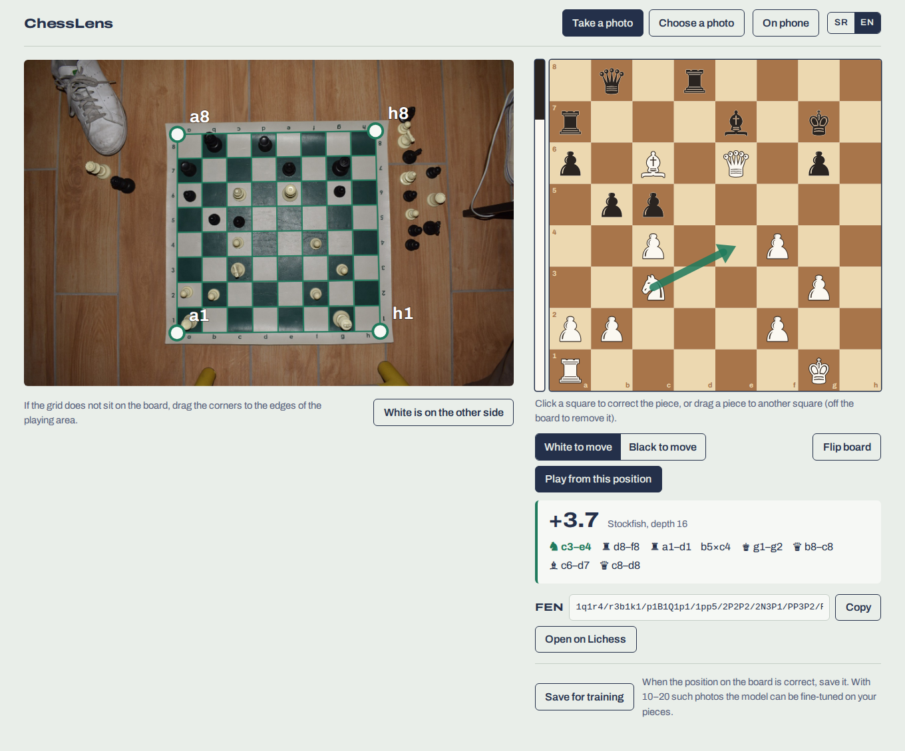
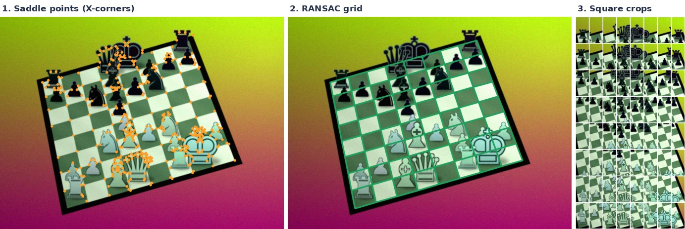

# ChessLens

ChessLens recognizes a chess position from a photo of a physical board, converts it to FEN and shows the best move (Stockfish). A misrecognized square can be fixed with one click, and if the detection misses the board, its four corners can be dragged into place. You can play on from the recognized position on the same board, and one button restores the position from the photo. The interface is available in English (default) and Serbian.



**Stack:** Python (OpenCV, NumPy, PyTorch → ONNX), FastAPI, React + TypeScript (Vite), Stockfish in the browser.

## How it works



1. **Board detection** (`chessvision/board.py`, no ML): find the points where four squares meet (saddle points), then RANSAC grows a single-square hypothesis into the full 8×8 grid. Board contours alone are not enough because pieces on the back rank cover the edge.
2. **Square crops** (`squares.py`): an upright 32×64 crop is cut from the photo for every square, tall enough to contain the whole piece.
3. **Classification** (`classifier.py`): a small CNN (0.84M parameters) predicts one of 13 classes (empty or one of 12 pieces). It is trained in PyTorch and runs on the server with onnxruntime.
4. **Orientation** (`squares.py`): h1 is a light square, and White is usually on the near side. When the rule is wrong, one button flips the board.
5. **Legal position** (`position.py`): the model's probabilities are turned into the most likely legal board (exactly one king per side, no pawns on the back ranks, ...).
6. **Analysis and play:** Stockfish runs in the browser (Web Worker), and [chess.js](https://github.com/jhlywa/chess.js) checks moves in game mode.

## Results

The whole system (detection + model + orientation), measured with `training/evaluate.py` on images not used for training:

| Test set | Square accuracy | Fully correct boards |
|---|---|---|
| Real photos, [samryan18](https://github.com/samryan18/chess-dataset) (98) | 99.3 % | 91.8 % |
| [chesscog](https://osf.io/xf3ka/) renders (342) | 99.5 % | 81.0 % |
| Synthetic images (300) | 98.5 % | 81.3 % |

Training data: chesscog (4,400 renders), 379 real photos from samryan18 and 1,500 synthetic images; 25 epochs on a GTX 1650. The previous model (HOG + MLP) recognized 65 % of the squares and no complete board on the chesscog test set.

**Limitation:** the real photos show a single board shot from above, and chesscog renders a single piece set. Accuracy is noticeably lower on other piece sets, at steep angles or with a diagonally rotated board. That is why the app has a *Save for training* button: corrected photos are stored in `data/feedback/` and can be used to fine-tune the model on your own board.

## Running

```bash
python -m venv .venv && source .venv/bin/activate
pip install -r requirements.txt
uvicorn backend.app:app --reload --port 8000

cd frontend && npm install && npm run dev    # http://localhost:5173
```

Without a terminal (Linux): `scripts/install_desktop.sh` adds *ChessLens* to the application menu. Clicking it starts the server and opens the browser, and the server stops by itself a few minutes after the app is closed. The server is also reachable from phones on the same Wi-Fi network: the *On phone* button shows a QR code with the address. A photo taken on the phone appears on the computer within a couple of seconds.

Docker: `docker build -t chesslens . && docker run -p 8000:8000 chesslens`

## Training

```bash
pip install -r requirements-train.txt

# data: synthetic images and chesscog (https://osf.io/xf3ka/)
python data/synth.py --out data/generated/synth_train --count 1500 --seed 2024
python data/chesscog.py --src ~/datasets/chesscog/train --out data/chesscog_train

# square crops, training, ONNX export
python training/make_dataset.py --data data/chesscog_train --out data/npz/chesscog.npz
python training/make_dataset.py --data data/generated/synth_train --out data/npz/synth.npz
python training/train_cnn.py --train data/npz/chesscog.npz data/npz/synth.npz --epochs 25 --out models/

python training/evaluate.py --data data/chesscog_test --models models/
```

Fine-tuning on your own board: `python training/make_dataset.py --data data/feedback --repeat 8 --out data/npz/feedback.npz`, then run `train_cnn.py` with the same datasets plus `feedback.npz` and `--init models/square_cnn.pt`.

## Tests

```bash
pip install -r requirements-dev.txt
pytest -q
```

## Project structure

```
chessvision/   board detection, square crops, model, chess rules, full pipeline (pipeline.py)
backend/       FastAPI server
frontend/      React app
data/          synthetic image generator and dataset converters
training/      crop dataset builder, CNN training, evaluation
models/        trained model (square_cnn.onnx, square_cnn.pt)
scripts/       launcher without a terminal (Linux)
tests/
```
